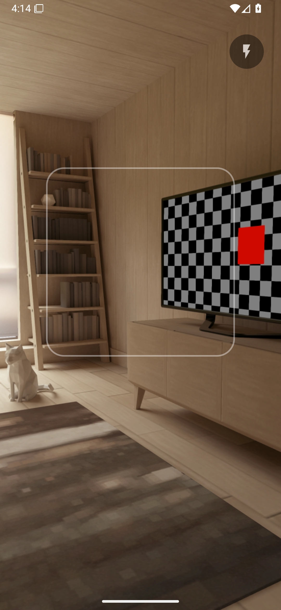

# QuickScan

A minimal, dark-mode QR scanner for Android. Point, get the result instantly, open or copy it, done.



## Features

- **Instant detection** — no shutter button; frames are analyzed continuously and the freshest one always wins. A haptic tick fires the moment a code decodes.
- **Distance scanning** — ML Kit zoom suggestions: when a QR is too small to decode reliably, the camera auto-zooms until it's readable. Pinch to take manual control, tap to focus.
- **URLs** — if the payload is http/https (bare `www.` links get `https://` added), an **Open** button hands it to the default browser.
- **Copy** — always available on the result card; the text is selectable too.
- **Dark only** — pure black AMOLED-friendly theme.
- **Lightweight & private** — ~6.6 MB APK, arm64-v8a only. The only permission is CAMERA; the bundled ML Kit model runs fully offline and the INTERNET permission is deliberately stripped from the merged manifest.

Tap the preview (or ✕ / back) to dismiss a result and resume scanning; zoom resets. Torch toggle top-right. Screen stays on while scanning.

## Build

```
./gradlew assembleRelease
```

Requires JDK 17+, an Android SDK with platform 37 (see `local.properties` for `sdk.dir`).

Release signing reads `KEYSTORE_PASSWORD` / `KEY_PASSWORD` from `local.properties` and expects `app/quickscan.keystore`. Without them, release builds come out unsigned — debug builds always work. The keystore is **not** in the repo; keep it (and the passwords) safe, since app updates must be signed with the same key.

## Tech

Kotlin, CameraX, Google ML Kit Barcode Scanning (bundled model, QR-only). One activity, classic views, no Compose — see [DESIGN.md](DESIGN.md) for the full design rationale.
